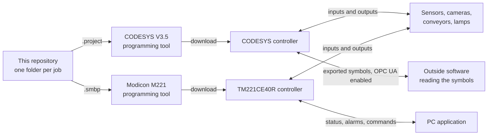

<div align="center">

<h1>Systems One PLC</h1>

<p>
The PLC programs that Systems One has written for its machines and customer sites,<br>
kept in one place: one folder per job, each holding the controller project<br>
and, where it exists, the list of signals the controller shares with other software.
</p>

<p>
<a href="#documentation">Documentation</a> &middot;
<a href="#what-the-system-can-do">Projects and capabilities</a> &middot;
<a href="Bex/Bex%20-%20I_O%20List%20August%202023.xlsx">Bex I/O list</a> &middot;
<a href="Bex/PC-PLC%20Messages%20Modbus.xlsx">Bex PC-PLC messages</a>
</p>

</div>

## Contents

- [What it does](#what-it-does)
- [What the system can do](#what-the-system-can-do)
- [How it fits together](#how-it-fits-together)
- [Status](#status)
- [Get started](#get-started)
- [Documentation](#documentation)
- [Repository layout](#repository-layout)
- [Reference](#reference)

## What it does

This repository is a store of PLC projects, not one application. Each top-level
folder is a separate job. To work on a job you open its project file in the
vendor's programming tool, change it, download it to the controller and commit
the saved project back here.

- Eight folders each hold one CODESYS project file (`.project`). The `Snowsoft`
  folder also holds compile output for a second project, `Boom_Control`, whose
  project file is not in the repository.
- One folder (`Bex`) holds a Schneider Electric Modicon M221 project (`.smbp`)
  together with its I/O list, drive settings and PC message list.
- Six of the CODESYS projects also have an exported symbol file (`.xml`). It
  lists the variables the controller makes available to outside software, and it
  is the only readable description of those projects in the repository.
- Three projects also have a CODESYS project archive (`Archive.prj`).

The project files are binary. Their logic can only be read in the programming
tool, so everything below about what a project does comes from the exported
symbol files, the Bex project file (which is XML) and the file names.

## What the system can do

Nothing in this repository shows whether a project is installed and running on
site. There are no tests, no simulation files and no commissioning records. Each
group below says what the description is based on.

### CODESYS projects with an exported symbol file

Written and compiled: each has compile output from CODESYS committed next to it.
Not proven by anything in this repository. All six symbol files were produced
with the profile "CODESYS V3.5 SP16 Patch 4+" and have OPC UA support switched
on in the symbol configuration.

| Area | Capability |
| --- | --- |
| [AutoTrigger](AutoTrigger/) | Drives one output named `CognexOutput` from two timers, `tInterval` and `tPulse`, with a pulse request flag. Six symbols. |
| [Arca_Print](Arca_Print/) | One output, `Apply_Label`, and one flag, `Label_Applied`. Two symbols. |
| [PEPKOR](PEPKOR/) (project `Divert`) | Photo-eye trigger input and Cognex trigger output; `Good_Read`, `No_Read` and `Bad_Data` outputs; a first-in first-out buffer of up to 21 integers (`FB_FIFO`) with `Data`, `Data_Ready` and `Data_Release`; conveyor healthy, running and direction inputs; heartbeat with timeout, `PC_Ready`, `Software_Healthy` and `Software_Error`; red, orange and green lamp flags. 27 symbols. |
| [Stingray](Stingray/) | State machine (`Current_State`, `Next_State`, `Prev_State`); in-place photo-eye with an alignment alarm block (`FB_Photoeye_Allignment_Alarm`); Cognex trigger; good read and bad read; `API_Result_Pass` and `API_Result_Fail`; parcel release and parcel removed; heartbeat watchdog block (`FB_HeartbeatWatchdog`); red, orange and green lamps and a siren. 24 symbols. |
| [TracesolCrossCheck](TracesolCrossCheck/) | Label applicator signals (ready, air pressure, arm in and out, label present, label running low, label applied, fire, reset); four photo-eyes (scan station start and end, print station, palletiser) with an error flag for each; stop outputs for four conveyors (`C1_Stop` to `C4_Stop`); triggers for a check scan and two inspection cameras with read and no-read results; `SKU_Match`, `SKU_NoMatch`, `CheckScan_Match` and `CheckScan_NoMatch`; beacon lamps for the scan station and the print station; main, printer and photo-eye state numbers; hardware and software override, PLC reset and heartbeat. 70 symbols, all in one global variable list. |
| [Snowsoft](Snowsoft/) (project `Boom_Control`) | The exported symbol file holds only CODESYS system entries (compiler version, runtime version, I/O configuration). It says nothing about the boom control logic. |

### CODESYS projects with no readable export

A project file is committed and nothing else describes it. What these projects
do cannot be stated from the repository.

| Area | Capability |
| --- | --- |
| [Snowsoft](Snowsoft/) (project `Snowsoft`) | Project file and compile output. [E_16DI.csv](Snowsoft/E_16DI.csv) is a CODESYS mapping export for a 16-input device named `E_16DI`; no variables are mapped in it. |
| [Semi_Auto_Swad](Semi_Auto_Swad/) | Project file only. No compile output and no symbol file. |
| [Twinsaver](Twinsaver/) | Project file only. No compile output and no symbol file. |

### Bex conveyor system (Modicon M221)

Written. The project file is readable XML, so the items below are taken from it
directly. Not proven by anything in this repository.

| Area | Capability |
| --- | --- |
| Controller | The project is configured for a TM221CE40R controller. Ladder logic, 96 rungs in 16 sections. |
| Alarms | Sections for general alarm, start-up alarm, safety alarm and sensor faults. Rung comments cover emergency stop, drive trips, photo cells not working and an alarm acknowledge push button. |
| Conveyors | Sections for conveyors 1, 2 and 3 and for scale conveyor 1, each with automatic start and stop bits and a running signal from its variable speed drive. |
| Product handling | Sections for product detection, product spacing on conveyor 1 and "product too close" on conveyor 2. Rung comments cover camera good read and bad read, a hand scanner and restart after a bad read. |
| Link to the PC | Sections for communication out, communication in and the COM port. Rung comments cover sending status and alarms to the PC and receiving application-running and hand-scanner signals from it. |
| Other | A section named `CONTROL` and a section for the cooling fan and interface. |

## How it fits together



The repository does not record which controller hardware the CODESYS projects
run on, nor which program reads their symbols.

| Part | What it does | Folder |
| --- | --- | --- |
| CODESYS project (`.project`) | The program, device configuration and I/O mapping for one controller. Binary; opened in CODESYS. | Every folder except [Bex](Bex/) |
| Symbol file (`.Device.Application.xml`) | Lists each variable the controller exposes, with its type, access (read or read-write) and, for I/O, its address. | [Arca_Print](Arca_Print/), [AutoTrigger](AutoTrigger/), [PEPKOR](PEPKOR/), [Snowsoft](Snowsoft/), [Stingray](Stingray/), [TracesolCrossCheck](TracesolCrossCheck/) |
| Compile output (`.compileinfo`, `.bootinfo`, `.bootinfo_guids`) | Files CODESYS writes when it builds the project. | Same folders as the symbol files |
| Project archive (`Archive.prj`) | A CODESYS project archive (a zip) holding a copy of the project and its compile output. | [AutoTrigger](AutoTrigger/), [PEPKOR](PEPKOR/), [Stingray](Stingray/) |
| Option files (`.opt`) | CODESYS settings saved beside the project, one for all users and one per user. | Every CODESYS folder |
| M221 project (`.smbp`) | The ladder program and hardware configuration for the Bex conveyor system. | [Bex](Bex/) |
| Bex spreadsheets and logo PDFs | I/O list, drive settings, PC message list and two Bex logo files. | [Bex](Bex/) |

## Status

"Last change" is the date of the last commit that touched the folder. The
repository has 23 commits, from 2025-09-04 to 2026-03-05, no tags, no releases
and no CI.

| Part | State | Last change |
| --- | --- | --- |
| AutoTrigger | Project, compile output, symbol file and archive committed. The archive is dated 2025-06-23 and its copy of the project is a different size from the committed project file, so the two are not the same version. | 2025-10-08 |
| Arca_Print | Project, compile output and symbol file committed. | 2025-11-07 |
| PEPKOR (`Divert`) | Project, compile output, symbol file and archive committed. The archive is dated 2026-03-04 and its copy of the project is a different size from the committed project file. | 2026-03-05 |
| Stingray | Project, symbol file, archive and `.compileinfo` committed. No `.bootinfo` file, unlike the other compiled projects. The archive is dated 2026-03-02. | 2026-03-05 |
| TracesolCrossCheck | Project, compile output and symbol file committed. Some inputs are still named as placeholders (`Bit7`, `Bit12` to `Bit15`) and four photo-eye inputs carry a `TEMP_` prefix. | 2026-02-09 |
| Snowsoft (`Snowsoft` and `Boom_Control`) | Two sets of compile output and option files, but only `Snowsoft.project` is committed. There is no `Boom_Control.project` in the repository. | 2026-02-09 |
| Semi_Auto_Swad | Project file and option files only. | 2026-02-20 |
| Twinsaver | Project file and option files only. | 2025-10-30 |
| Bex | Project file named "Bex CT 03 August 2023". The Ethernet configuration has the Modbus server enabled; the separate Modbus TCP mapping setting is switched off. | 2025-11-21 |
| Tests | None. | |
| Documentation | Only the Bex spreadsheets. The README files in `AutoTrigger` and `Snowsoft` are one-line placeholders. | |

## Get started

You need:

- Git.
- CODESYS V3.5 SP16 Patch 4 or later to open the `.project` files. That is the
  version recorded in the symbol files; the repository does not say which
  device packages or libraries each project needs.
- The Schneider Electric programming software for the Modicon M221 to open the
  Bex `.smbp` file. The project file records project version 2.8.0.0.

There is nothing to build or run from the command line. Clone the repository and
open the project file for the job in its programming tool:

```
git clone <repository URL>
cd Systems_One_PLC
```

> [!WARNING]
> Logging in to a controller, downloading a project or writing a variable
> changes a live machine. Conveyors, label applicators and diverters can move.
> Do it only at the machine, with the people on site aware, and never against a
> controller you have not identified.

When you save a project in CODESYS it also rewrites the option files and the
compile output next to it, so expect those files to change in the same commit.

## Documentation

| I want to | Go to |
| --- | --- |
| See the Bex motors, instruments, digital and analog inputs, outputs and internal bits | [Bex/Bex - I_O List August 2023.xlsx](Bex/Bex%20-%20I_O%20List%20August%202023.xlsx) |
| See the messages exchanged between the PC and the Bex PLC | [Bex/PC-PLC Messages Modbus.xlsx](Bex/PC-PLC%20Messages%20Modbus.xlsx) |
| See the Bex variable speed drive settings (CWF 300) | [Bex/Bax - CWF 300 VSD Seting.xlsx](Bex/Bax%20-%20CWF%20300%20VSD%20Seting.xlsx) |
| Read the Bex ladder program without the programming tool | [Bex/Bex CT 03 August 2023.smbp](Bex/Bex%20CT%2003%20August%202023.smbp) (XML) |
| Get the Bex logo | [horizontal, white](Bex/BEX%20new%20logo%20white%20-%20horizontal.pdf), [stacked, on red](Bex/BEX_Logo%20-%20stacked%20on%20red.pdf) (PDF) |
| See which variables AutoTrigger exposes | [AutoTrigger.Device.Application.xml](AutoTrigger/AutoTrigger.Device.Application.xml) |
| See which variables Arca_Print exposes | [Arca_Print.Device.Application.xml](Arca_Print/Arca_Print.Device.Application.xml) |
| See which variables the PEPKOR divert exposes | [Divert.Device.Application.xml](PEPKOR/Divert.Device.Application.xml) |
| See which variables Stingray exposes | [Stingray.Device.Application.xml](Stingray/Stingray.Device.Application.xml) |
| See which variables TracesolCrossCheck exposes | [TracesolCrossCheck.Device.Application.xml](TracesolCrossCheck/TracesolCrossCheck.Device.Application.xml) |
| See the Snowsoft boom control symbol file | [Boom_Control.Device.Application.xml](Snowsoft/Boom_Control.Device.Application.xml) |
| See the Snowsoft 16-input device mapping | [Snowsoft/E_16DI.csv](Snowsoft/E_16DI.csv) |
| Read the folder README for AutoTrigger or Snowsoft (placeholders) | [AutoTrigger/README.md](AutoTrigger/README.md), [Snowsoft/README.md](Snowsoft/README.md) |
| Read the licence (MIT) | [LICENSE](LICENSE) |

## Repository layout

| Folder | What is in it |
| --- | --- |
| [Arca_Print](Arca_Print/) | CODESYS project `Arca_Print`, compile output, symbol file. |
| [AutoTrigger](AutoTrigger/) | CODESYS project `AutoTrigger`, compile output, symbol file, project archive, placeholder README. |
| [Bex](Bex/) | Modicon M221 project for the Bex conveyor system, three spreadsheets, two Bex logo PDFs. |
| [PEPKOR](PEPKOR/) | CODESYS project `Divert`, compile output, symbol file, project archive. |
| [Semi_Auto_Swad](Semi_Auto_Swad/) | CODESYS project `Semi_Auto_Swad`. |
| [Snowsoft](Snowsoft/) | CODESYS project `Snowsoft`, compile output for `Snowsoft` and `Boom_Control`, the `Boom_Control` symbol file, a device mapping export, placeholder README. |
| [Stingray](Stingray/) | CODESYS project `Stingray`, compile output, symbol file, project archive. |
| [TracesolCrossCheck](TracesolCrossCheck/) | CODESYS project `TracesolCrossCheck`, compile output, symbol file. |
| [Twinsaver](Twinsaver/) | CODESYS project `Twinsaver`. |

## Reference

The text below is the README as it was before this overview was written. The
`AutoTrigger` and `Snowsoft` folder READMEs contain the same two lines.

<details><summary><b>Original README</b></summary>

# Systems_One_PLC
Repository for Systems-One PLC Code

</details>
